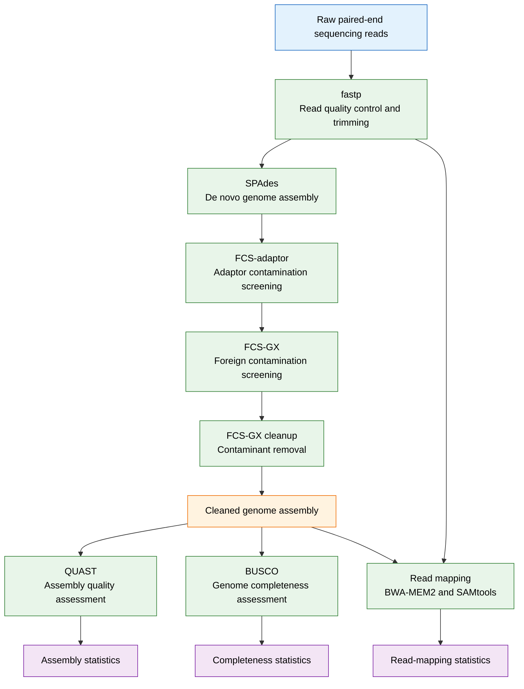

# GenomeFlow

### An automated Nextflow-based genome assembly workflow

---

## Introduction

GenomeFlow is a bioinformatics workflow developed using Nextflow to automate genome assembly, contamination screening, and assembly quality assessment from paired-end Illumina sequencing data.

This walkthrough was developed as a training resource for ARSEF project members on the USDA-ARS SCINet Ceres system. This walkthrough provides step-by-step instructions for preparing input data (raw Illumina reads), configuring workflow parameters, executing the workflow, monitoring computational jobs, and interpreting the resulting output files.

**Note:** This repository contains only documentation for GenomeFlow use. The underlying workflow source code is not currently publicly distributed.

---

## Table of Contents

- [Workflow Overview](#workflow-overview)
- [Step 1: Getting Started](#step-1-getting-started)
- [Step 2: Preparing Input Files](#step-2-preparing-input-files)
- [Step 3: Selecting Workflow Options](#step-3-selecting-workflow-options)
- [Step 4: Running GenomeFlow](#step-4-running-genomeflow)
- [Step 5: Monitoring Progress](#step-5-monitoring-progress)
- [Step 6: Reviewing Your Results](#step-6-reviewing-your-results)
- [Troubleshooting](#troubleshooting)

---

## Workflow Overview

GenomeFlow uses Nextflow to automatically handle the submission and execution of the different software needed in a genome assembly pipeline.

Each step of the pipeline is a different module/process, and is submitted as a separate slurm job. Multiple samples can be run concurently without interferring with each other.

### Workflow Architecture



### Tools and Software

For version/citaion reference.

[fastp](https://github.com/OpenGene/fastp) | Read quality control. Performs quality filtering and adaptor trimming of raw sequencing reads.

[SPAdes](https://github.com/ablab/spades) | Genome assembly. Generates de novo genome assemblies from quality-filtered sequencing reads.

[FCS-adaptor](https://github.com/ncbi/fcs) | Contamination screening. Identifies and removes adaptor contamination from assembled sequences.

[FCS-GX](https://github.com/ncbi/fcs) | Contamination screening. Identifies potential foreign organism contamination within genome assemblies.

FCS-GX cleanup  Assembly cleaning. Removes or trims contaminating sequences based on FCS-GX recommendations.

[QUAST](https://github.com/ablab/quast) | Assembly quality assessment. Calculates assembly statistics, including assembly size, contig counts, N50, and GC content.

[BUSCO](https://busco.ezlab.org/) | Genome completeness assessment.  Evaluates genome completeness using conserved single-copy orthologs.

[BWA-MEM2](https://github.com/bwa-mem2/bwa-mem2) | Read mapping. Aligns quality-filtered sequencing reads to their corresponding genome assemblies.

[SAMtools](https://www.htslib.org/) | Alignment processing. Processes read alignments and generates mapping statistics, such as coverage.

---

## Prerequisites

GenomeFlow is currently configured to run on the USDA SCINet Ceres system. Everthing software-wise is already taken care of.  You do not need to install anything or configure anything.

You just need:
- Your raw paired-end sequencing reads in FASTQ format, uploaded to Ceres.
- At least a vague idea of the taxonomic identity of your sample.
- Basic command line/terminal skills.


## Step 1: Getting Started

### 1. Connect to Ceres

```bash
ssh [your.name]@ceres.scinet.usda.gov
```

### 2. Locate GenomeFlow

Navigate to the GenomeFlow directory:

```bash
cd /project/arsef/projects/GenomeFlow
```

### 3. Activate the GenomeFlow environment

Load Miniconda and activate the preconfigured GenomeFlow software environment:

```bash
module load miniconda
source activate /project/arsef/environments/genomeflow
```

This environment contains the software dependencies required to execute GenomeFlow.

Verify that Nextflow is available:

```bash
nextflow -version
```

If the command successfully returns version information, you can proceed with preparing your input data.


## Step 2: Preparing Input Files

### Sequencing reads

GenomeFlow requires paired-end Illumina sequencing reads in FASTQ format (`.fastq.gz`, `.fastq`, `.fq`, etc).

Each sample should have at least two files, corresponding to the forward (R1) and reverse (R2) reads.

### Create a sample sheet

GenomeFlow uses a comma-separated file (`.csv`) to identify which samples to process.

Create a file called `samplesheet.csv` with the following four columns:

| Column | Description |
|---|---|
| `sample` | A unique name for your sample. Avoid spaces and special characters. |
| `fastq_1` | Full path to the R1 sequencing reads. |
| `fastq_2` | Full path to the R2 sequencing reads. |
| `expected_taxon` | Expected scientific name of the organism. Leave blank if unknown. |

An example sample sheet containing three samples is shown below:

```csv
sample,fastq_1,fastq_2,expected_taxon
Sample1,/path/to/Sample1_R1.fastq.gz,/path/to/Sample1_R2.fastq.gz,Fusarium virguliforme
Sample2,/path/to/Sample2_R1.fastq.gz,/path/to/Sample2_R2.fastq.gz,Beauveria bassiana
Sample3,/path/to/Sample3_R1.fastq.gz,/path/to/Sample3_R2.fastq.gz,
```

You can create this file in Excel and save it as a CSV file.

**Important:**
- Do not change the column names.
- Use a unique sample name for each sample.
- Provide the full path to each FASTQ file on Ceres.
- Include one row per sample.
- You can include as many samples as needed.

Save your sample sheet somewhere accessible on Ceres. You will provide the path to this file when running GenomeFlow.


---


## Step 3: Selecting Workflow Options

GenomeFlow has several customizable parameters. Most users can leave the default settings unchanged.

### General Parameters

| Parameter | Description | Default | Required? |
|---|---|---|---|
| `--input` | Path to your sample sheet CSV file. | None | Yes |
| `--outdir` | Directory where results will be saved. | `results` | No |

**It is strongly recommended that you specify a unique output directory for each analysis.**

### Genome Assembly (SPAdes)

| Parameter | Description | Default |
|---|---|---|
| `--spades_kmers` | Comma-separated list of k-mer sizes used for assembly. | `21,33,55,77,99` |
| `--spades_cpus` | Number of CPUs allocated per assembly. | `16` |
| `--spades_memory` | Amount of memory allocated per assembly. | `96 GB` |

### Contamination Screening (FCS-GX)

| Parameter | Description | Default |
|---|---|---|
| `--fcs_batch_size` | Number of genome assemblies processed per FCS-GX batch. | `10` |
| `--fcs_cpus` | Number of CPUs allocated per FCS-GX batch. | `48` |
| `--fcs_memory` | Amount of memory allocated per FCS-GX batch. | `600 GB` |

### Genome Completeness (BUSCO)

| Parameter | Description | Default |
|---|---|---|
| `--busco_lineage` | BUSCO lineage dataset used to assess genome completeness. | `fungi_odb10` |

### Example BUSCO Lineages

Select a BUSCO lineage appropriate for your organism.

| Lineage | Organism group |
|---|---|
| `fungi_odb10` | Fungi |
| `ascomycota_odb10` | Ascomycete fungi |
| `basidiomycota_odb10` | Basidiomycete fungi |
| `sordariomycetes_odb10` | Sordariomycete fungi |
| `hypocreales_odb10` | Fungi within the order Hypocreales |
| `eukaryota_odb10` | Eukaryotes |

To view all BUSCO lineages currently available in our shared database, run:

```bash
ls /project/arsef/databases/busco_datasets/lineages
```

### General Recommendations

- If you are unsure which parameters to use, start with the defaults.
- Specify a unique output directory for each analysis.
- Increase SPAdes memory if your assemblies fail due to insufficient memory.
- Select a BUSCO lineage appropriate for your organism. If you don't know which to select, just go with the deafault "fungi".
- Leave the FCS-GX settings alone unless you encounter resource-related issues.

---


## Step 4: Running GenomeFlow

Since the full pipeline can take a while (several hours to over a day), GenomeFlow should be submitted as a SLURM job on Ceres. 

### 1. Create a submission script

Create a file called `run_genomeflow.sh` and copy the following script into it:

```bash
#!/bin/bash
#SBATCH --job-name=GenomeFlow
#SBATCH --account=arsef
#SBATCH --partition=ceres
#SBATCH --cpus-per-task=2
#SBATCH --mem=8G
#SBATCH --time=7-00:00:00
#SBATCH --output=GenomeFlow_%j.out
#SBATCH --error=GenomeFlow_%j.err

module load nextflow/25.04.6
module load miniconda

cd /project/arsef/projects/GenomeFlow

nextflow run main.nf \
    --input /path/to/samplesheet.csv \
    --outdir /path/to/results \
    -work-dir /path/to/work_directory
```

### 2. Modify the submission script

Before submitting your job, update the following paths:

| Parameter | What to provide |
|---|---|
| `--input` | Full path to your sample sheet. |
| `--outdir` | Directory where your results will be saved. |
| `-work-dir` | Directory where intermediate files will be stored. Preferably located on `/90daydata`. |

Use a unique output directory and working directory for each new analysis.

### 3. Customize your workflow (optional)

The submission script above uses all default GenomeFlow parameters.

If you would like to customize your analysis, add parameters from Step 3 to your Nextflow command.

For example:

```bash
nextflow run main.nf \
    --input /path/to/samplesheet.csv \
    --outdir /path/to/results \
    --spades_memory '128 GB' \
    --busco_lineage hypocreales_odb10 \
    -work-dir /path/to/work_directory
```

### 4. Submit your job

Navigate to the directory containing your submission script and run:

```bash
sbatch run_genomeflow.sh
```

You should receive a message similar to:

```
Submitted batch job 12345678
```

GenomeFlow will automatically submit additional SLURM jobs for each analysis. You do not need to submit these individually. At this point all you need to do is occasionally monitor the job progress to make sure everything is running ok.

You can now disconnect from Ceres without interrupting your analysis.

### 5. Resume an interrupted analysis (if needed)

If your workflow fails or reaches its time limit, add `-resume` to the end of your original Nextflow command:

```bash
nextflow run main.nf \
    --input /path/to/samplesheet.csv \
    --outdir /path/to/results \
    -work-dir /path/to/work_directory \
    -resume
```

Save and resubmit your SLURM script:

```bash
sbatch run_genomeflow.sh
```

Nextflow will reuse successfully completed tasks where possible.

**Important:** Do not delete your working directory or the `.nextflow` cache if you intend to resume your analysis. Keep the same paths and original parameters unless you need to correct a setting.

---


## Step 5: Monitoring Progress

### Check your running jobs

To check the status of your GenomeFlow analysis, run:

```bash
squeue --me
```

You will see the main `GenomeFlow` job as well as individual jobs submitted automatically by Nextflow.

Common job statuses include:

| Status | Meaning |
|---|---|
| `PD` | Pending — waiting for computational resources. |
| `R` | Running — actively processing. |
| `CG` | Completing — finishing the job. |

It is normal to see multiple Nextflow jobs running simultaneously.

### View workflow progress

Navigate to the directory where you submitted your SLURM script.

View the main GenomeFlow output log:

```bash
tail -f GenomeFlow_JOBID.out
```

Replace `JOBID` with the job ID assigned when you submitted GenomeFlow.

This will display the workflow's progress in real time.

Press `Ctrl + C` to stop viewing the log. This will not stop your analysis.

### Check for errors

If you encounter an error, check the corresponding SLURM error log:

```bash
cat GenomeFlow_JOBID.err
```

Also check the main output log, as Nextflow may report errors there.

### Check if your analysis is complete

Once your GenomeFlow job is no longer listed in `squeue --me`, check its final status:

```bash
sacct -j JOBID --format=JobID,JobName,State,Elapsed,ExitCode
```

A status of `COMPLETED` with an exit code of `0:0` indicates that the main job finished successfully.

Check the main output log to confirm that Nextflow completed successfully.

### Cancel your analysis (if needed)

To cancel your GenomeFlow analysis, run:

```bash
scancel JOBID
```

Use the job ID of the main GenomeFlow submission job.

Run `squeue --me` afterward to check whether any associated Nextflow jobs are still running. If necessary, cancel those jobs individually.


---

## Step 6: Reviewing Your Results

Once GenomeFlow has completed, navigate to your specified output directory.

### 1. Open the MultiQC report

GenomeFlow generates a MultiQC report that summarizes quality assessment results across all samples.

Download the `multiqc_report.html` file to your local computer using Globus or Open OnDemand and open it in your web browser.

The MultiQC report allows you to compare your samples and identify potential issues with sequencing quality, genome assembly, contamination, and genome completeness.

### 2. Assess genome assembly quality

The following metrics can help you determine whether your genome assemblies are suitable for downstream analyses.

| Metric | What it tells you | What to look for |
|---|---|---|
| Read quality | Quality of the input sequencing reads. | High-quality reads following filtering. |
| Total assembly length | Total size of the assembled genome. | Similar to the expected genome size of your organism. |
| Number of contigs | How fragmented the assembly is. | Generally, fewer contigs are preferable. |
| N50 | A measure of assembly contiguity. | Generally, higher values are preferable. |
| GC content | Percentage of guanine and cytosine bases. | Similar to closely related organisms. |
| Complete BUSCOs | Estimated genome completeness. | Ideally above 95%. |
| Duplicated BUSCOs | Conserved genes found in multiple copies. | Unexpectedly high values may indicate assembly redundancy or biological duplication. |
| Missing BUSCOs | Conserved genes not detected in the assembly. | Ideally as low as possible. |
| Read mapping percentage | Percentage of sequencing reads mapping back to the assembly. | Generally, higher values are preferable. |
| Sequencing depth | Average sequencing coverage across the assembly. | Sufficient coverage for reliable genome assembly. |

There is no one perfect and universal metric for a good genome assembly. Consider these metrics together and compare them with previously published genomes of closely related organisms.

### 3. Assess contamination

GenomeFlow uses two NCBI Foreign Contamination Screening (FCS) tools to identify contamination. These are are especially necessary if you eventually want to upload your genomes to NCBI! 

When you upload genomes to NCBI, NCBI will run their own version of FCS on them, but life is much easier if you run this on your genomes as well. 

| Tool | Contamination detected |
|---|---|
| FCS-adaptor | Sequencing adaptors and other synthetic sequences. |
| FCS-GX | Sequences potentially originating from organisms other than the expected organism. |

When reviewing contamination results, consider all of these:

- The number of sequences flagged as contaminants.
- The total number of bases flagged or removed.
- The percentage of the original assembly removed.
- The taxonomic identity of the detected contaminants.

A small amount of contamination does not necessarily indicate that an assembly is unusable. GenomeFlow removes or trims sequences according to the contamination cleanup procedure.

If you have any genomes with substantial contamination, they should be investigated further before being used in downstream analyses.

### Understanding FCS-GX recommendations

| Action | Meaning |
|---|---|
| `EXCLUDE` | The entire sequence is recommended for removal. |
| `TRIM` | A contaminating region at the end of a sequence is recommended for removal. |
| `FIX` | An internal region is flagged for correction. |
| `REVIEW` | Potential contamination that requires further investigation. |
| `REVIEW_RARE` | A less common potential contamination finding that requires review. |
| `INFO` | Informational finding that does not necessarily require removal. |

Always review samples with substantial contamination or unresolved FCS-GX recommendations.

### 4. Locate your final genome assemblies

GenomeFlow generates both original and contamination-cleaned genome assemblies.

For downstream analyses, you should use the final contamination-cleaned FASTA files rather than the original SPAdes assemblies.


### Uses for these assemblies 

These final assemblies can be used for:

- Gene prediction (such as [GRAIN](https://github.com/KScott6/GRAIN_Pipeline) and functional annotation.
- Phylogenomic analyses (such as [cano.py](https://github.com/KScott6/cano.py)).
- Comparative genomics
- Genome database submission (such as [NCBI Genome Database](https://www.ncbi.nlm.nih.gov/datasets/genome/))

Make sure to review the assembly quality and contamination results before proceeding with downstream analyses.

<br>

#### I **HIGHLY** recommend submitting your genome assemblies to NCBI and getting them cleared **BEFORE** moving forward with gene prediction, functional annotation, important dissertation/manuscript research, etc.

<br>

### 5. Additional output files

Individual analysis reports are also available if you want to look at them closer.


| Output | Contents |
|---|---|
| fastp | Sequencing read quality reports. |
| SPAdes | Original genome assemblies. |
| FCS-adaptor | Adaptor contamination reports. |
| FCS-GX | Foreign contamination reports and cleanup recommendations. |
| QUAST | Detailed genome assembly statistics. |
| BUSCO | Detailed genome completeness results. |
| Read mapping | Read alignment and sequencing coverage statistics. |
| MultiQC | Combined quality assessment report across samples. |
| `pipeline_trace.tsv` | Workflow execution and computational resource usage statistics. |
| `pipeline_timeline.html` | Visualization of workflow execution times. |


And you are done! 

<br>
<br>

---


## Troubleshooting

| Problem | What to do |
|---|---|
| My jobs are pending (`PD`). | Wait for computational resources to become available. This is normal. |
| GenomeFlow cannot find my sequencing reads. | Check the file paths and filenames in your sample sheet. |
| GenomeFlow cannot read my sample sheet. | Verify that the file is saved as a CSV and contains the required column names. |
| SPAdes runs out of memory. | Increase `--spades_memory` in your submission script and resume the workflow. |
| FCS-GX runs out of memory. | Consider reducing `--fcs_batch_size` or increasing `--fcs_memory`. |
| GenomeFlow reaches its time limit. | Resubmit your job with `-resume` and increase the SLURM time limit if needed. |
| BUSCO cannot locate the selected lineage. | Verify that the selected lineage is available in the shared BUSCO database. |
| My workflow fails unexpectedly. | Check the SLURM output and error logs to identify the failed process. |
| My assembly has substantial contamination. | Review the FCS-GX reports before using the assembly for downstream analyses. |

In most cases, failed workflows can be restarted using `-resume` without repeating successfully completed analyses.

Do not delete your working directory or Nextflow cache until you have confirmed that your analysis is complete.


## Getting Help

GenomeFlow and this walkthrough were developed by Kelsey Scott.

If you encounter an issue while running GenomeFlow, please provide the following information when asking for help:

- Your GenomeFlow SLURM job ID.
- Your sample sheet.
- Your SLURM submission script.
- The relevant output and error logs.
- A brief description of the issue.

